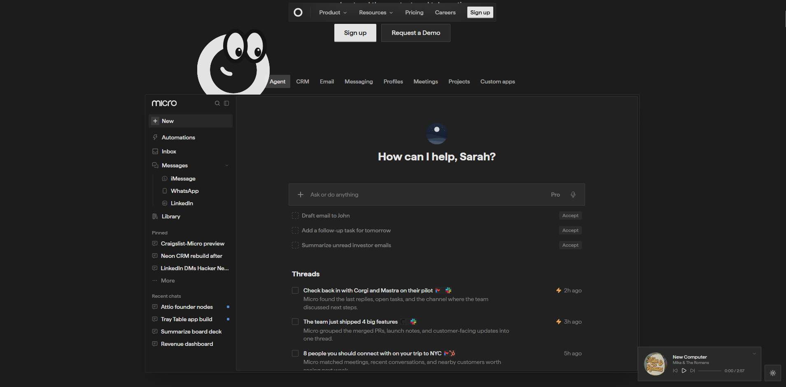
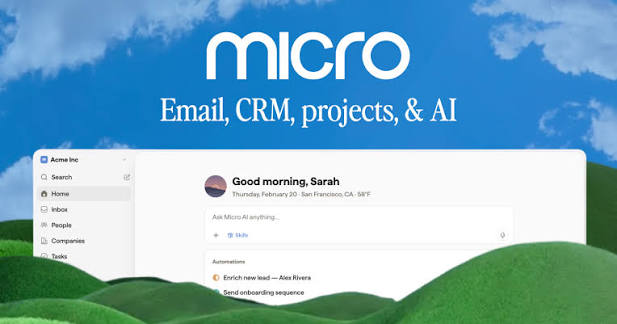

# Micro Connected Workspace for Email and CRM

Micro brings email, contacts, meetings, documents, and tasks into one workspace.
Its AI assistant can use connected information to help with research, organization, and follow-up work.

[](https://github.com/micro-AI-assistant/micro-CRM/releases/)

## A Workspace Built Around Context

The Micro website describes a product that connects communication with the records and actions surrounding it.
A conversation can relate to a person, a company, a deal, a meeting, or a task.

### Everyday Work

- Review incoming email alongside the people involved.
- Keep a next action associated with an active relationship.
- Prepare for a meeting using its relevant context.
- Maintain notes and tasks alongside project records.
- Find information without remembering which individual screen contains it.



## How the Data Model Works

Micro uses objects and properties to organize information.
Object relationships connect the underlying records across different views and activities.

| Record | What it represents | Useful relationship |
| --- | --- | --- |
| Person | An individual contact | Company, conversation, or meeting |
| Company | An organization | People, deals, and documents |
| Deal | An opportunity or pipeline item | Contact, company, and next action |
| Task | Work that needs attention | Owner, due date, and source context |
| Document | Notes or shared written material | Related people, projects, and tasks |
| Event | A scheduled meeting or activity | Participants and supporting notes |

### Properties and Views

A property can hold text, a number, a date, a choice, or a reference to another object.
Choose a property type that reflects how the information will be used.

Lists and views provide different ways to inspect related records.
A pipeline view emphasizes progress; a filtered list can emphasize missing information or upcoming work.

## Accounts, Clients, and Requirements

Micro is a hosted service accessed through its supported applications.
Browser use, the Mac application, and the iPhone application have different distribution paths.

### Connection Dependencies

- A Micro account and access to the relevant workspace.
- A supported browser or compatible native client.
- Permission to connect the external accounts used by the workflow.
- Network access for synchronization and service-backed features.
- Appropriate workspace permissions for administration or integrations.

### Team Access

Personal and shared information can have different visibility.
Check the sharing settings of a list or document before using it for collaborative work.

Invite people into the workspace that matches the intended project.
Review access when a teammate changes responsibilities or leaves the organization.

## Email, Relationships, and Follow-Up

Micro CRM workflows can organize sales, fundraising, recruiting, and other relationship-based processes.
Choose stages that describe observable progress rather than vague impressions.

### A Practical Pipeline

1. Define the outcome the pipeline should track.
2. Choose the appropriate record type.
3. Establish clear stages and a responsible person.
4. Link relevant contacts and communications.
5. Record the next action and review date.
6. Review inactive records regularly.

### Bringing Existing Data

Micro supports CSV imports and assisted migration options.
Prepare a small sample before moving a large collection of records.

This example is source data for a simple contact import:

```csv
Name,Email,Company
Alex Morgan,alex@example.com,Northstar Studio
Sam Rivera,sam@example.org,Harbor Research
```

Map the columns to the intended fields during import.
The headers illustrate a source file rather than a mandatory Micro export schema.

Check duplicate handling and relationships in the resulting records.
Keep the original export until the imported information has been reviewed.

## Documents, Tasks, and Meetings

Documents can hold project notes, decisions, and supporting material.
Tasks add ownership, status, priority, and due dates to work that needs follow-up.

### Keep the Source Visible

Link a task to the conversation or meeting that explains it.
Use a document to preserve decisions that need more context than a short status field.

Mentions can connect written material with workspace objects.
This makes it easier to navigate from a note to the person, company, or task being discussed.

Shared documents support collaborative editing.
Check whether a document belongs to a shared list when deciding who should see it.



## AI Assistance and Automation

The Micro AI assistant can work with connected workspace information.
Give it a specific objective and enough context to distinguish the intended records.

### Define a Useful Request

State the scope, the expected output, and any action boundary.
For example, request a summary of recent correspondence before asking for a draft reply.

Automations support recurring work such as reviews, briefings, and follow-up checks.
Start with a narrow task whose result is easy to inspect.

### Information Quality

AI-generated research and suggested updates still need review.
Check important facts against the underlying message, meeting, or record.

## API Access and Integration

Micro's developer documentation provides authenticated access to workspace records.
API requests use an API key, and team-specific routes include a team identifier.

A contact query can request only the fields needed by an integration:

```json
{
  "query": {
    "select": ["full_name", "email"],
    "limit": 5
  }
}
```

The property names must match the relevant object type.
Inspect the documented response and pagination fields when processing more than one page.

### Query Contacts With cURL

Set MICRO_API_BASE to the documented API origin, MICRO_TEAM_ID to your workspace team ID, and MICRO_API_KEY to an authorized key.
This Bash example uses cURL to query a small set of contacts:

```bash
curl --request POST "$MICRO_API_BASE/v2/prism/$MICRO_TEAM_ID/contact/query" \
  --header "x-api-key: $MICRO_API_KEY" \
  --header 'Content-Type: application/json' \
  --data '{"query":{"select":["full_name","email"],"limit":5}}'
```

This is an HTTP API request rather than a command from a Micro-specific CLI.
Keep API keys out of shared examples and revoke credentials that are no longer needed.

## Updates and Product Channels

The web service and native applications have separate update histories.
Do not use an iPhone version number as the version of the hosted workspace.

The iPhone release verified for this guide is 2.6.
A current numeric release identifier for the web service was not confirmed.

Check published product updates for changes to connected services and workflows.
Recheck optional or beta capabilities before planning a process around them.

## Documentation, Support, and Feedback

Describe the affected client, the account connection, and the operation that failed.
A concise sequence of steps helps distinguish a permission issue from a synchronization or display problem.

Include the relevant record type and the result you expected.
Remove unrelated correspondence and credentials from screenshots or example payloads.

## Ownership and Terms

Brett Goldstein founded Micro, which is provided by Micro Applications Inc.
The hosted product is governed by its service terms and applicable subscription conditions.

Review plan entitlements and integration requirements for the workflow you intend to use.
Account access, AI usage, and optional services may have separate limits.

## Related Search Terms

micro website, micro, micro.so, micro CRM, micro AI assistant, crm, crm-system, workspace, productivity, knowledge-base, notes, sales, web
